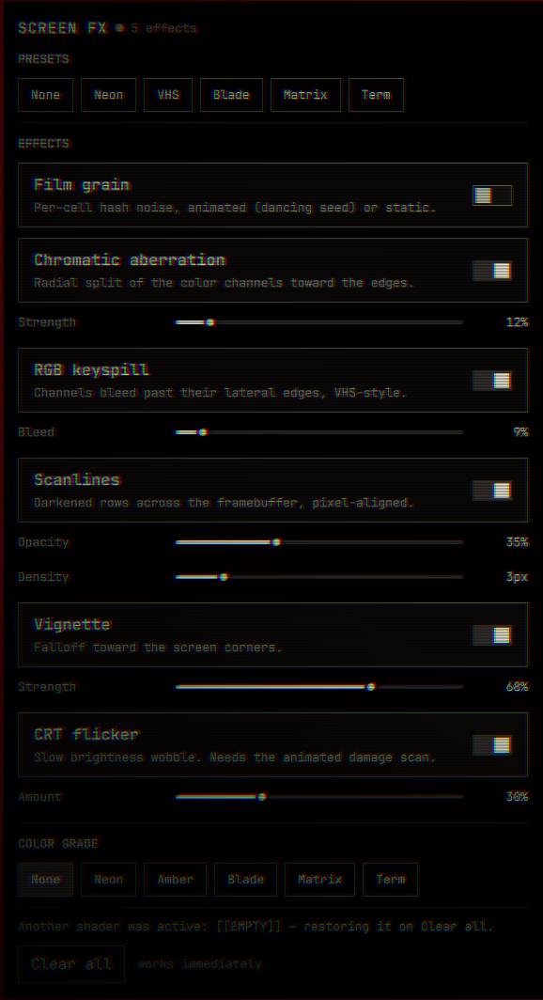

# Screen FX

Whole-screen retro monitor filters for the Omarchy desktop, pushed straight
onto the GPU through Hyprland's screen shader slot. Film grain, chromatic
aberration, RGB keyspill, scanlines, vignette and CRT flicker — plus a set of
one-click presets and color grades.



Inside the bar is a small wand-sparkle button that opens the Screen FX lab:
toggle individual effects, drag their parameters, and pick a preset.

## Install

```sh
omarchy plugin add https://github.com/rogueinsiderpodcast-hub/monitor-aesthetics.git --enable
```

## Use

Click the Screen FX wand in the bar to open the lab, or drive it headlessly:

```sh
omarchy-shell fichte.screenfx preset vhs
omarchy-shell fichte.screenfx clear
omarchy-shell fichte.screenfx setEffect grain true
omarchy-shell fichte.screenfx setParam grain intensity 0.5
omarchy-shell fichte.screenfx grade neon
```

### Presets

- **None**
- **Neon** — cyberpunk keyspill
- **VHS** — heavy grain, keyspill, scanlines and flicker
- **Blade** — cinematic desaturate + vignette
- **Matrix** — green phosphor, static grain
- **Term** — CRT terminal phosphor

### Effects

| Effect        | Params                                  |
|---------------|-----------------------------------------|
| Film grain    | intensity, cell size, animated/static   |
| Chromatic aberration | strength                         |
| RGB keyspill  | bleed                                   |
| Scanlines     | opacity, density                        |
| Vignette      | strength                                |
| CRT flicker   | amount                                  |
| Color grade   | neon / amber / blade / matrix / term    |

## Requirements

- Omarchy (Hyprland-based desktop)
- `hyprctl` (ship with Hyprland)
- `glslangValidator` for shader validation before apply

An animated stack (animated grain or CRT flicker) needs `debug:damage_tracking=0`
to repaint; Screen FX sets it, remembers your previous value, and restores it
when the stack goes static or is cleared. If another tool had a screen shader
active, it is left untouched while the plugin is idle and restored on
"Clear all" instead of being lost.

## Compatibility

Screen FX targets Hyprland's `decoration:screen_shader` slot. It is written
for the Omarchy Quattro shell.

## Remove

```sh
omarchy plugin remove fichte.screenfx
```

State written to `~/.local/state/screenfx/` is left behind; delete that folder
to fully clean up.

## License

MIT — see [LICENSE](LICENSE).